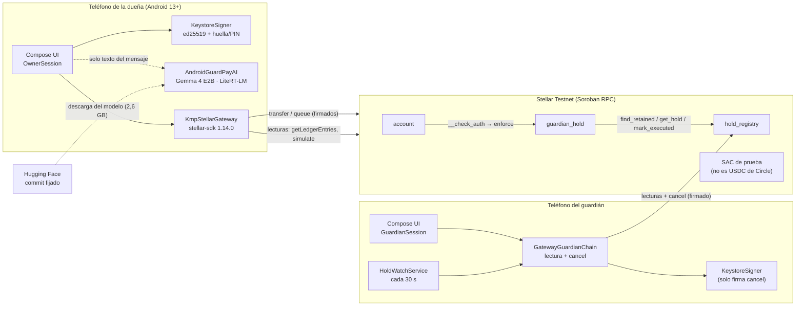
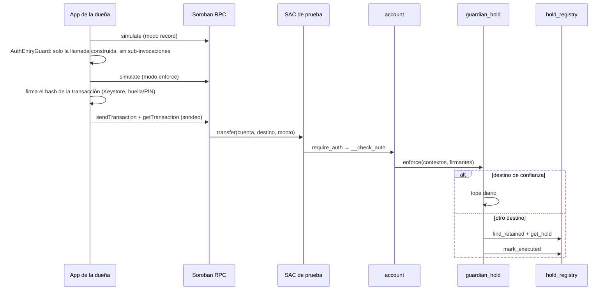

# Arquitectura de GuardPay

Este documento describe solo los componentes que existen en el repositorio a fecha del 12 oct 2026 (commit base `d3cdb51`). Cada afirmación lleva su etiqueta: **[FACT]** se comprobó leyendo el código o ejecutando algo; **[INFERENCE]** es una deducción a partir del código; **[UNVERIFIED]** no se comprobó. Los hallazgos citados (`F-xx`) están en [`AUDIT_REPORT.md`](AUDIT_REPORT.md).

## 1. Vista general

GuardPay tiene dos mitades y ningún servidor propio **[FACT]**:

- **En la cadena** (Stellar Testnet, Soroban): tres contratos en Rust (`contracts/`).
- **En el teléfono**: una app Kotlin Multiplatform (`app/`) con la interfaz en Compose Multiplatform. Android es la plataforma real; iOS corre solo una simulación en memoria, en el simulador del CI de macOS.

No hay backend, base de datos, push (FCM/APNs) ni pagador de comisiones **[FACT]** (`AndroidManifest.xml` declara solo INTERNET, notificaciones, servicio en primer plano y biometría).

## 2. Contratos (Cargo workspace)

| Crate | Archivo | Responsabilidad | Funciones públicas |
| --- | --- | --- | --- |
| `account` | `contracts/account/src/lib.rs` | Cuenta inteligente de la dueña, armada con OpenZeppelin `stellar-accounts` | `__constructor`, `__check_auth` (y nada más) **[FACT]** |
| `guardian_hold` | `contracts/guardian_hold/src/lib.rs` | Política: lista cerrada de operaciones permitidas | `install`, `enforce`, `uninstall` (siempre falla), `spent_today` **[FACT]** |
| `hold_registry` | `contracts/hold_registry/src/lib.rs` | Registro de pagos retenidos | `queue`, `cancel`, `mark_executed`, `get_hold`, `find_retained`, `list_retained` **[FACT]** |

Dependencias: `soroban-sdk = 28.0.0`; OpenZeppelin `stellar-contracts` vendorizado en `vendor/` y fijado al commit `b40c5ea` (pre-release) **[FACT]** (`Cargo.toml`, `docs/DEPENDENCIES.md`).

### 2.1 `account`

- El constructor crea **una sola** regla de contexto `Default` con firmante `Delegated(owner)` y la política `guardian_hold` **[FACT]**.
- No expone `execute`, `upgrade` ni funciones de administración (`add_context_rule`, `add_signer`, `remove_*`) **[FACT]**. Por lo tanto, el código y las reglas de una cuenta desplegada no se pueden cambiar **[INFERENCE]**.
- `__check_auth` delega en `do_check_auth` de OpenZeppelin, que vincula `context_rule_ids` al digest firmado **[FACT]** (la prueba GH-31 lo cubre).

### 2.2 `guardian_hold` (política)

`enforce` se ejecuta dentro de `__check_auth` de la cuenta **[FACT]**:

1. `smart_account.require_auth()` y comprobación de que el firmante autenticado es la dueña (`Signer::Delegated(owner)`).
2. Para cada contexto autorizado:
   - llamada a la propia cuenta → rechazo;
   - `transfer` del token configurado (`usdc`) desde la cuenta:
     - destino **de confianza** (hasta 3) → solo rama de **tope diario** (día UTC, `checked_add`, `CapExceeded` si se pasa). **No consulta el registro** (ver F-01);
     - cualquier otro destino → `registry.find_retained(cuenta, token, destino, monto)`, exige `ready_at` cumplido y llama a `mark_executed`;
   - `hold_registry.queue` con la propia cuenta como argumento y monto > 0 (no comprueba el token, ver F-06);
   - cualquier otra cosa (incluidos `approve`, `transfer_from`, otros tokens y contextos que no son de contrato) → rechazo.
3. La política nunca llama a un token **[FACT]**.

Configuración por cuenta (`install`, una sola vez): dueña, token, 1–3 contactos, registro y tope diario > 0. `uninstall` siempre falla con `NotAllowed` **[FACT]**.

### 2.3 `hold_registry`

- El constructor guarda **un único** guardián y **una única** dirección `guardian_hold` por despliegue **[FACT]**. Cada cuenta usa su propio despliegue del registro **[FACT]** (el cliente rechaza una cuenta cuya política apunta a otro registro, `KmpStellarGateway.policyConfig`).
- `queue`: exige la autorización de la cuenta, monto > 0, rechaza un duplicado activo y calcula `ready_at = created_at + 120 s`. `ready_at` **no** es un parámetro **[FACT]**.
- `cancel`: solo el guardián; `Retained → Stopped` **[FACT]**.
- `mark_executed`: solo `guardian_hold`; `Retained → Executed` **[FACT]**.
- Almacenamiento `persistent`, con TTL extendido; los registros no se borran **[FACT]**.
- `find_retained`, `list_retained` y la comprobación de duplicados en `queue` recorren linealmente todos los ids de la cuenta (`0..next_id`) **[FACT]** (ver F-02).
- No existe expiración en cadena: un pago madurado se puede enviar en cualquier momento posterior **[FACT]**.
- No tiene ninguna función que mueva tokens **[FACT]**.

### 2.4 Flujo de autorización de un pago

## 3. Cliente (Gradle KMP)

Módulos: `:app:shared` (lógica e interfaz) y `:app:android` (shell de Android). `iosApp/` es un proyecto XcodeGen que envuelve `MainViewController()` **[FACT]**.

| Paquete (`app/shared/src/commonMain/.../shared/`) | Contenido |
| --- | --- |
| `domain` | Los 9 estados de pago, sus transiciones y `predictLane` (predicción informativa del carril; el contrato es la autoridad) |
| `ai` | `GuardPayAI` (una sola función, `analyzeMessage`), `AnalysisParser`, `ModelStatus` |
| `signing` | Interfaz `Signer` |
| `stellar` | `StellarGateway`, `KmpStellarGateway`, `AuthEntryGuard`, `SubmitClassifier`, `ChainDecoders`, `ContractAbi`, `TestnetConfig`, `GuardPayNetwork` |
| `simulation` | `SimulatedStellarGateway` en memoria (iOS y Android debug sin `testnet.json`) |
| `ui` | Pantallas de entrada, dueña (Inicio, Pagar, Detalle), guardián y `HoldWatcher` |

Código específico de plataforma:

- `androidMain/ai`: `AndroidGuardPayAI` (LiteRT-LM 0.17.1, GPU con caída a CPU) y `GemmaModelFile` (descarga desde un commit fijado de Hugging Face, reanudable, con tamaño y SHA-256) **[FACT]**.
- `iosMain`: `IosGuardPayAI` siempre "no disponible" **[FACT]**.
- `app/android/.../signing`: `KeystoreSigner` (ed25519 en Android Keystore, API 33+, autenticación por uso) y `BiometricSigningPrompt` **[FACT]**.
- `app/android/.../notifications`: `HoldWatchService` (servicio `dataSync` en primer plano, cada 30 s) y `HoldNotifications` **[FACT]**.
- `app/android/src/debug/Wiring.kt`: claves del Keystore + `testnet.json` del directorio externo de la app; si falta o no coincide, simulación **[FACT]**.
- `app/android/src/release/Wiring.kt`: sesiones nulas; el build de release no se conecta a nada **[FACT]**.

### 3.1 Fronteras que el build comprueba

Tareas registradas en `app/shared/build.gradle.kts` y ejecutadas por `allTests` **[FACT]**:

| Tarea | Qué impide |
| --- | --- |
| `checkCommonMainArchitecture` | imports de `android.*`, `androidx.*` (salvo Compose), `platform.*`, LiteRT-LM, WebAuthn/passkey en `commonMain` |
| `checkDependencyGraph` | que `ai/` mencione `signing`/`stellar`/`Signer`/`StellarGateway`, que un archivo de producción mezcle `GuardPayAI` con ellos, o que un `Fake*` llegue a producción |
| `checkUiVocabulary` | "seguro", "protegido" o "verificado" en literales de la interfaz |
| `checkGuardianSurface` | que `ui/guardian/**` mencione `StellarGateway`, `Signer`, `submitTransfer`, `submitQueue` o el paquete `signing` |

Son comprobaciones **textuales** (expresiones regulares sobre el código fuente), no un análisis del grafo de tipos **[FACT]**.

### 3.2 Integración con Stellar, por etapa

| Etapa | Estado | Base |
| --- | --- | --- |
| Interfaz simulada | Existe (`SimulatedStellarGateway`) | **[FACT]** código y pruebas |
| Integración del SDK | `KmpStellarGateway` sobre stellar-sdk 1.14.0 | **[FACT]** código, compila |
| Conexión a la red | Soroban RPC por `https://` (obligatorio en `GuardPayNetwork`), red fija `Network.TESTNET` | **[FACT]** código |
| Transacción construida | `buildTx` + doble simulación (record y enforce) | **[FACT]** código. La construcción real solo la ejercitan las pruebas `*LiveTest` (no corridas en esta auditoría); offline se prueban sus piezas (`AuthEntryGuardTest`, `ChainDecodersTest`, `SubmitClassifierTest`) |
| Transacción firmada | Hash firmado con el Keystore | **[FACT]** código; las firmas reales constan en `evidence/` (esta auditoría no firmó nada) |
| Transacción enviada | `sendTransaction` | **[FACT]** cinco hashes de `evidence/demo/scene-1.md`, `scene-3.md` y `scene-4.md` existen en Horizon testnet (consulta de solo lectura, 12 oct) |
| Transacción confirmada | `getTransaction` hasta `SUCCESS`/`FAILED` o cierre de la ventana de validez | **[FACT]** esos cinco hashes figuran con `successful: true` y el mismo ledger y hora que la evidencia |

Esta auditoría no firmó ni envió ninguna transacción; solo leyó la red. El detalle está en [`AUDIT_REPORT.md`](AUDIT_REPORT.md#4-integración-con-stellar-por-etapa).

## 4. Datos y configuración

- `testnet.json` (debug): solo direcciones públicas y la URL del RPC; lo escribe `DeviceProvisioningLiveTest` y se copia con `adb push` **[FACT]**. `TestnetConfig.parse` valida formatos, que dueña y guardián sean distintos y 1–3 contactos **[FACT]**.
- `keys.json` (debug): la app escribe las direcciones G públicas de sus dos claves **[FACT]**.
- Semillas de los scripts de despliegue: en `scripts/.testnet/`, ignorado por git **[FACT]** (`.gitignore`). No hay semillas en archivos versionados ni en el historial según el escaneo de esta auditoría (ver `AUDIT_REPORT.md`, sección 5).
- Modelo de IA: nunca en el APK ni en el repositorio; se descarga en el directorio externo de la app **[FACT]**.

## 5. Despliegue y CI

- Despliegue de contratos: `scripts/deploy-testnet.ps1` / `.sh`, solo testnet **[FACT]**. Cuentas desplegadas: `evidence/stellar/deployment.md` y la tabla del [`README.md`](README.md#para-revisión-técnica).
- `.github/workflows/ci.yml` (Ubuntu): `cargo test --locked` de los tres contratos y `:app:shared:allTests` + `assembleDebug` + `compileReleaseKotlin`, sin red **[FACT]**. No compila el wasm (`stellar contract build`) **[FACT]**.
- `.github/workflows/ios.yml` (macOS, rama `ios`): enlaza `shared` y corre la app y XCUITest en el simulador, en simulación **[FACT]** (último resultado observado: `success` en `d3cdb51`).

## 6. Límites de esta descripción

- No se leyó cada línea de `vendor/` (OpenZeppelin); se asume su comportamiento según la documentación del propio repositorio **[UNVERIFIED]**.
- Los límites de recursos de Soroban (lecturas por transacción, instrucciones) para el recorrido lineal del registro no se midieron **[UNVERIFIED]**.
- Nada de esta descripción aplica a mainnet: el proyecto no tiene despliegue en mainnet **[FACT]**.
