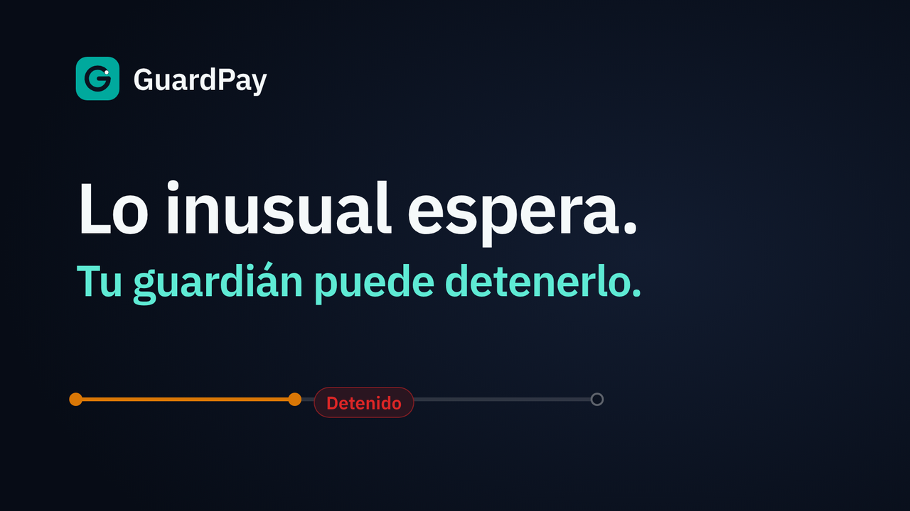
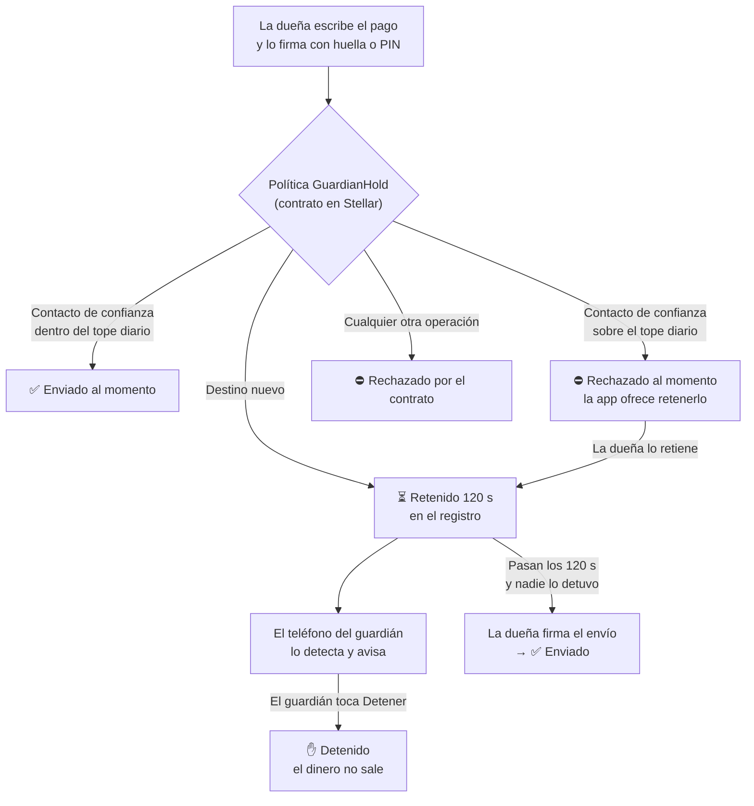
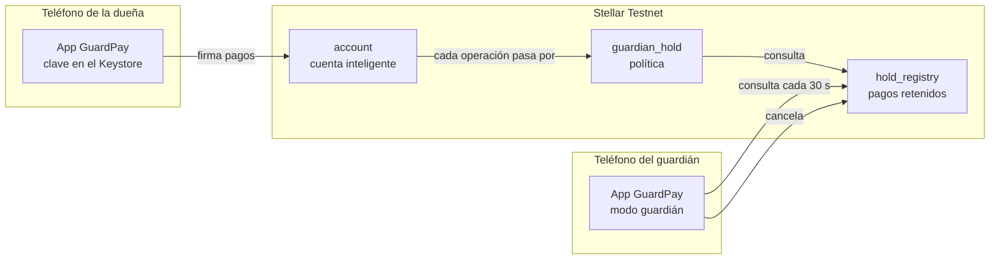

<a id="readme-top"></a>

<div align="center">


<h1>GuardPay</h1>



<br /><br />

[![Red: Stellar Testnet][testnet-shield]][testnet-url]
[![Estado: MVP en testnet][estado-shield]](#capacidades-y-estado)
[![Contratos sin auditar][auditoria-shield]](#limitaciones-conocidas)
[![CI: contratos y app][ci-main-shield]][ci-main-url]
[![CI iOS (simulador)][ci-shield]][ci-url]

<p><strong>Una billetera que le da tiempo a alguien de confianza para detener un pago sospechoso antes de que salga.</strong></p>

<p><em>La IA advierte. Tú firmas. Tu guardián puede detener. El contrato rechaza lo demás.</em></p>

<p>
  <a href="#cómo-funciona"><strong>Cómo funciona »</strong></a>
  <br /><br />
  <a href="#inicio-rápido">Inicio rápido</a>
  &middot;
  <a href="evidence/demo/full-rehearsal.md">Demo cronometrada</a>
  &middot;
  <a href="#capacidades-y-estado">Estado</a>
  &middot;
  <a href="https://github.com/CHMP987/GuardPay/issues">Reportar un problema</a>
</p>

</div>

<table>
  <tr>
    <td align="center" width="33%"></td>
    <td align="center" width="33%"></td>
    <td align="center" width="33%"></td>
  </tr>
  <tr>
    <td align="center"><sub><b>1.</b> La dueña paga a una cuenta nueva. El contrato lo <b>retiene</b>.</sub></td>
    <td align="center"><sub><b>2.</b> El teléfono del guardián recibe un <b>aviso</b>.</sub></td>
    <td align="center"><sub><b>3.</b> El guardián lo <b>detiene</b>. El dinero no sale.</sub></td>
  </tr>
</table>

<p align="center"><sub>Capturas reales del 8 oct 2026 en Stellar Testnet. La dueña usó un teléfono Android y el guardián un emulador. Fuente: <a href="evidence/demo/full-rehearsal.md"><code>evidence/demo/full-rehearsal.md</code></a>.</sub></p>

> [!IMPORTANT]
> GuardPay es un **MVP que corre solo en Stellar Testnet**, con dinero de prueba. Los contratos **no están auditados**. No es un producto listo para usar con fondos reales.
>
> La corrección [F-01](AUDIT_REPORT.md#f-01) (enviar un pago retenido a un contacto de confianza) está desplegada en testnet desde el 12 oct, pero solo la usan las cuentas nuevas. Desde el 13 oct, el teléfono (dueña) y el emulador (guardián) apuntan a una cuenta nueva con F-01, pero el envío de una retención a un contacto todavía no se probó desde ellos. La cuenta publicada y la de ataques siguen con la política anterior.

<details>
  <summary><b>Contenido</b></summary>
  <ol>
    <li><a href="#el-problema">El problema</a></li>
    <li><a href="#la-solución">La solución</a></li>
    <li><a href="#cómo-funciona">Cómo funciona</a></li>
    <li><a href="#capacidades-y-estado">Capacidades y estado</a></li>
    <li><a href="#limitaciones-conocidas">Limitaciones conocidas</a></li>
    <li><a href="#demostración">Demostración</a></li>
    <li><a href="#pantallas-y-estados-de-pago">Pantallas y estados de pago</a></li>
    <li><a href="#ia-en-el-teléfono">IA en el teléfono</a></li>
    <li><a href="#privacidad-y-datos">Privacidad y datos</a></li>
    <li><a href="#cómo-está-construido">Cómo está construido</a></li>
    <li><a href="#inicio-rápido">Inicio rápido</a></li>
    <li><a href="#desarrollo-y-calidad">Desarrollo y calidad</a></li>
    <li><a href="#estructura-del-repositorio">Estructura del repositorio</a></li>
    <li><a href="#para-revisión-técnica">Para revisión técnica</a></li>
    <li><a href="#documentación">Documentación</a></li>
    <li><a href="#próximos-pasos">Próximos pasos</a></li>
    <li><a href="#contribuir-seguridad-y-soporte">Contribuir, seguridad y soporte</a></li>
    <li><a href="#licencia">Licencia</a></li>
    <li><a href="#créditos">Créditos</a></li>
  </ol>
</details>

## El problema

En muchas estafas por mensaje, quien pierde el dinero es la misma persona que **autoriza el pago**. El mensaje es urgente: un familiar en apuros, un supuesto banco, un premio que hay que cobrar ya. Bajo presión, la persona transfiere a una cuenta que nunca había visto.

En ese momento la víctima tiene la clave y quiere pagar, así que las protecciones habituales no sirven. Cuando alguien de confianza se entera, el dinero ya salió y no hay vuelta atrás.

En Costa Rica, el estudio de mercado del proyecto no encontró ninguna protección que permita a otra persona intervenir antes de que el pago sea irreversible ([`docs/GuardPay — MVP Proposal.md`](docs/GuardPay%20—%20MVP%20Proposal.md)).

<p align="right">(<a href="#readme-top">volver arriba</a>)</p>

## La solución

GuardPay es una billetera móvil sobre Stellar que **separa los pagos habituales de los riesgosos** y deja que una persona de confianza frene los riesgosos.

- **Los pagos habituales salen al momento.** Si el destino es un contacto de confianza y el monto cabe en el tope diario, el pago sale sin espera.
- **Lo inusual espera.** El propio contrato **retiene 120 segundos** cualquier pago a un destino nuevo.
- **El guardián puede detenerlo.** La dueña elige a esa persona. El guardián recibe un aviso en su teléfono y puede detener el pago mientras sigue retenido.
- **El guardián no puede mover el dinero.** No es firmante de la cuenta; solo puede detener.
- **Las reglas no dependen de la app.** Las aplica un contrato en Stellar, así que una app modificada no se las salta. Quien robe la clave de la dueña sigue sujeto a esas mismas reglas: puede pagar a los contactos dentro del tope, pero cualquier otro pago espera 120 s y el guardián puede detenerlo.

**Qué lo diferencia de una billetera convencional.** En una billetera común, la firma de la dueña basta para mover todo. En GuardPay, esa firma pasa además por una política en cadena que decide si el pago sale, espera o se rechaza. Además, hay un tercero que puede frenar el pago sin tener poder sobre los fondos.

Ninguna de estas piezas es nueva por separado: la retención con tiempo (como `TimelockController` de OpenZeppelin), los guardianes (Argent/Ready) y los avisos de pago (Yandex Pay, Monzo) ya existen. GuardPay las combina en una cuenta de Stellar construida con piezas de OpenZeppelin. En EVM se podría hacer algo parecido con Safe, un módulo de retraso y un *guard*.

<p align="right">(<a href="#readme-top">volver arriba</a>)</p>

## Cómo funciona



1. **La dueña paga.** Elige el destino y el monto. Antes de firmar, la app le dice si el pago saldrá ahora ("Sale ahora") o con espera ("Con espera"). Firma con huella o PIN; la clave nunca sale del teléfono.
2. **El contrato decide.** Cada operación de la cuenta pasa por la política `GuardianHold`, que solo admite cuatro casos:
   - un pago a un contacto de confianza (hasta 3) dentro del tope diario;
   - poner un pago en espera en el registro;
   - enviar un pago retenido que ya cumplió su espera y coincide exactamente en cuenta, moneda, destino y monto;
   - que el guardián cancele un pago retenido.

   Todo lo demás se rechaza.
3. **El guardián se entera.** Su teléfono consulta la red cada 30 segundos y le avisa cuando aparece un pago retenido. No hay ningún servidor de por medio.
4. **El guardián decide.** Desde el aviso ve el destino y el monto, y puede detener el pago. Un pago detenido ya no puede salir, aunque la dueña vuelva a firmar.
5. **Si nadie lo detiene**, la dueña puede enviarlo cuando pasan los 120 segundos.

### Quién puede hacer qué

| | Puede | No puede |
| --- | --- | --- |
| **Dueña** | Pagar a sus contactos, retener pagos a destinos nuevos y enviarlos tras la espera | Saltarse la espera, aprobar a terceros (`approve`) ni usar otras monedas desde la cuenta |
| **Guardián** | Ver y detener los pagos retenidos de la dueña | Firmar pagos, mover fondos ni cambiar reglas. No es firmante de la cuenta. |
| **Contrato** | Decidir si una operación sale, espera o se rechaza | Mover dinero por su cuenta: el registro no tiene ninguna función que transfiera fondos |
| **IA** *(solo Android)* | Leer un mensaje en el teléfono y sugerir precaución | Firmar, rellenar el destino o el monto, ni ver saldos, contactos o claves |

<p align="right">(<a href="#readme-top">volver arriba</a>)</p>

## Capacidades y estado

✅ hecho y con evidencia · 🟡 parcial · ❌ no existe. La columna "Dónde" dice dónde se comprobó cada cosa.

| Capacidad | Estado | Dónde | Evidencia |
| --- | --- | --- | --- |
| Tres contratos desplegados (`account`, `guardian_hold`, `hold_registry`) | ✅ | Testnet. Release del 6 oct y release F-01 del 12 oct, con el wasm del CI. Las cuentas creadas antes de la release F-01 siguen con la política del 6 oct. El teléfono y el emulador se reprovisionaron con F-01 el 13 oct. | [`deployment.md`](evidence/stellar/deployment.md) |
| Pago inmediato a contactos de confianza dentro del tope diario | ✅ | Testnet | [`scene-1.md`](evidence/demo/scene-1.md) |
| Retención de 120 s para destinos nuevos | ✅ | Testnet | [`scene-2.md`](evidence/demo/scene-2.md) |
| Retener un pago a un contacto y enviarlo después (sobre el tope, o porque la dueña eligió retenerlo) | 🟡 | Testnet, sobre el tope, con una cuenta desechable de la prueba en vivo. Dentro del tope, solo en los contratos y en la simulación. El teléfono y el emulador ya tienen una cuenta con F-01 (13 oct), pero el caso no se probó desde ellos. | [F-01](AUDIT_REPORT.md#f-01), [`gateway-live.md`, corrida 6](evidence/stellar/gateway-live.md#corrida-6-política-f-01-12-oct) |
| El guardián detiene un pago desde el aviso | ✅ | Testnet, entre un teléfono y un emulador | [`scene-3.md`](evidence/demo/scene-3.md), [`two-devices-android.md`](evidence/demo/two-devices-android.md) |
| El guardián no es firmante y no puede mover fondos | ✅ | Testnet, comprobado en la cadena y con ataques | [`scene-5.md`](evidence/demo/scene-5.md), [`rules-onchain.md`](evidence/smart-account/rules-onchain.md) |
| El contrato rechaza `approve`, los envíos retenidos sin esperar y los pagos detenidos | ✅ | Testnet | [`full-rehearsal.md`](evidence/demo/full-rehearsal.md), [`bypass-matrix.md`](evidence/security/bypass-matrix.md) |
| Clave de firma en el Android Keystore, con huella o PIN | ✅ | Emulador y teléfono: `transfer`, `queue` y `cancel` | [`physical-phone.md`](evidence/demo/physical-phone.md) |
| Las cuatro pantallas (Inicio, Pagar, Detalle, Guardián) con datos de testnet | ✅ | Emulador y teléfono | [`rehearsal.md`](evidence/demo/rehearsal.md) |
| Pantalla "Reglas de esta cuenta", leída de la cadena | ✅ | Testnet | [`r1-6-reglas.png`](evidence/demo/full-rehearsal/r1-6-reglas.png) |
| Aviso al guardián sin servidor (consulta cada 30 s) | 🟡 | Emulador con la app viva: 5 medidas, de 1,9 a 21,3 s. No se midió con la app cerrada ni en un teléfono físico. | [`notification.md`](evidence/guardian/notification.md) |
| Análisis de mensajes con IA en el teléfono | ✅ en Android · ❌ en iOS | Teléfono (12 oct). Ver [IA en el teléfono](#ia-en-el-teléfono). | [`benchmark.md`](evidence/ai/benchmark.md) |
| App en iOS | 🟡 | Solo el simulador del CI de macOS, con la simulación en memoria | [`simulator.md`](evidence/ios/simulator.md) |
| Ataques adversarios GH-01…GH-33 | 🟡 | GH-29, GH-30 y GH-33 sin correr | [`bypass-matrix.md`](evidence/security/bypass-matrix.md) |
| Demo completa de seis escenas | ✅ | Testnet, dos corridas por debajo de 5 min | [`full-rehearsal.md`](evidence/demo/full-rehearsal.md) |
| Entrevistas con usuarios | ❌ | No corridas | [`interviews.md`](evidence/interviews.md) |
| Cambiar de guardián o recuperar la cuenta | ❌ | No existe | — |
| Avisos push (FCM/APNs) o con la app cerrada | ❌ | No existe; por diseño no hay backend | — |
| Build de release conectado | ❌ | El build de release no se conecta a nada | — |

Lo pendiente está en [`ROADMAP.md`](ROADMAP.md) y el detalle por fase en [`docs/ESTADO-FASES.md`](docs/ESTADO-FASES.md). La revisión del 12 oct 2026 está en [`AUDIT_REPORT.md`](AUDIT_REPORT.md); no es una auditoría profesional. Las firmas de revisión humana CP-3, CP-7 y CP-9 siguen pendientes.

<p align="right">(<a href="#readme-top">volver arriba</a>)</p>

## Limitaciones conocidas

- **Solo testnet.** El activo es un token de prueba (un SAC emitido por la dueña), no el USDC de Circle. La dueña es la administradora de ese token. `mint` y `clawback` no pasan por la política, y no se ejecutaron con esa clave.
- **Contratos sin auditar.** OpenZeppelin está fijado a un commit previo a una versión estable (`b40c5ea`), no al tag v0.7.2.
- **Las cuentas creadas antes de la release F-01 corren la política anterior.** La cuenta publicada, la de ataques y las cuentas anteriores de los dispositivos no pueden enviar un pago retenido a un contacto de confianza ([F-01](AUDIT_REPORT.md#f-01)). Las cuentas no tienen `upgrade`, así que cada dispositivo se reprovisiona con una cuenta nueva. El teléfono y el emulador ya se reprovisionaron el 13 oct ([`two-devices-f01.md`](evidence/demo/two-devices-f01.md)).
- **Si el guardián no mira, nadie detiene nada.** La espera es fija, de 120 segundos. Un pago retenido que ya maduró no caduca dentro del contrato.
- **El guardián no se puede cambiar**, y no hay recuperación de cuenta.
- **El diálogo de firma no muestra el pago.** El sistema muestra "Firmar en Stellar", pero la clave firma un hash sin ver el destino ni el monto. Eso lo cubren la retención en cadena y la vista del guardián; la clave no lo cubre.
- **El aviso depende de que el servicio siga vivo.** El teléfono del guardián consulta la red cada 30 s desde un servicio en primer plano. El sistema puede detenerlo por ahorro de batería, restricciones del fabricante, un cierre forzado o el tope de unas 6 h al día de los servicios `dataSync` en Android 15+. Si lo detiene, el aviso llega cuando se abre la app o se toca "Actualizar". Una consulta cada 30 s gasta demasiada batería para producción.
- **El registro crece sin límite.** Cada `queue` y cada `transfer` de USDC recorre todos los registros de la cuenta. Con muchos registros, podría superar los límites de Soroban. No se midió ([F-02](AUDIT_REPORT.md#f-02)).
- **Los pagos inmediatos no se releen.** Un pago a un contacto queda en la cadena, pero desaparece de "Recientes" si se reinicia la app. Los pagos retenidos sí se vuelven a leer del registro.
- **Las pruebas cubren poco hardware.** Se probó en un emulador Android (API 37) y en un teléfono. El ciclo retener → esperar → enviar y los casos GH-01 y GH-24 no se repitieron en el teléfono físico. No hubo dos teléfonos físicos.
- **La demo cronometrada usó dos cuentas.** Las escenas de app y las de terminal corrieron sobre cuentas distintas, y las manejó un guion, no una persona presentando.
- **El build de release no se conecta a nada todavía.**

<p align="right">(<a href="#readme-top">volver arriba</a>)</p>

## Demostración

Las seis escenas de la demo corrieron **dos veces seguidas, sin fallos, en 3:46 y 3:35 minutos**, el 8 oct 2026 en Stellar Testnet. El hash de cada transacción se comprobó en Horizon. El detalle está en [`evidence/demo/full-rehearsal.md`](evidence/demo/full-rehearsal.md).

| # | Escena | Resultado |
| --- | --- | --- |
| 1 | Pagar 10 USDC de prueba a "Mamá", un contacto de confianza | Enviado al momento |
| 2 | Pagar 150 a una cuenta nueva e intentar enviarlo sin esperar | Retenido; el envío inmediato se rechaza |
| 3 | El guardián lo detiene desde el aviso | Detenido, también en el teléfono de la dueña |
| 4 | La dueña intenta enviar el pago detenido | Rechazado por el contrato |
| 5 | El guardián intenta transferirse dinero a sí mismo | Rechazado: no es firmante |
| 6 | Aprobar a un tercero (`approve`) o añadir una regla nueva | `approve` rechazado. La cuenta no tiene ninguna función para añadir reglas y sigue con 1 regla. |

<table>
  <tr>
    <td align="center" width="33%"></td>
    <td align="center" width="33%"></td>
    <td align="center" width="33%"></td>
  </tr>
  <tr>
    <td align="center"><sub>Pago a un contacto: sale al momento.</sub></td>
    <td align="center"><sub>Vista del guardián: puede detener, no mover dinero.</sub></td>
    <td align="center"><sub>La cuenta tiene 1 regla y el guardián no es firmante.</sub></td>
  </tr>
</table>

Las escenas de terminal (2, 4, 5 y 6) usaron otra cuenta de testnet, con claves desechables, porque las claves del Keystore no salen del teléfono. Un guion manejó los dispositivos; una persona puso la huella.

Más material:
- [Dos dispositivos](evidence/demo/two-devices-android.md): la dueña en el teléfono y el guardián en el emulador. **Real**.
- [Teléfono físico](evidence/demo/physical-phone.md): las escenas 1, 2, 3 y 6 en el teléfono. **Real**.
- [Vídeos de los ensayos](evidence/demo/video.md).

<p align="right">(<a href="#readme-top">volver arriba</a>)</p>

## Pantallas y estados de pago

La app tiene cuatro pantallas:
- **Inicio:** el saldo, una línea de estado de las reglas en Stellar, la tarjeta del guardián, los pagos en espera, los recientes y los contactos de confianza con lo que queda del tope de hoy.
- **Pagar:** el destino, el monto, el carril previsto ("Sale ahora" o "Con espera") y la lectura opcional del mensaje.
- **Detalle:** el estado de un pago, la línea de espera (Retenido → Listo → Enviado) con el guardián sobre el tramo de espera, y la acción que permite ese estado.
- **Guardián:** los pagos retenidos de la cuenta que vigila, con la opción de detenerlos.

Cada pago está siempre en uno de **nueve estados**: Borrador, Firmando, Retenido, Listo para enviar, Enviado, Detenido, Vencido, Rechazado y Error de red. La app solo muestra "Retenido" cuando existe un registro en la cadena. Hay capturas de los nueve estados a 360 dp en [`evidence/demo/screens/`](evidence/demo/screens/). Son **simuladas**: es la interfaz real, pero dibujada sin red.

El diseño (paleta, contraste, estados y pantallas) lo define [`docs/GuardPay — Propuesta visual.md`](docs/GuardPay%20—%20Propuesta%20visual.md).

<p align="right">(<a href="#readme-top">volver arriba</a>)</p>

## IA en el teléfono

La IA **advierte; no decide**. Lee el mensaje que acompaña un pago y puede sugerir retenerlo. La retención la impone el contrato, no la IA.

| | |
| --- | --- |
| Qué hace | Una sola función: lee el texto y devuelve "sugerir retener" o "sin señales claras" |
| Qué no puede hacer | Firmar, rellenar destino o monto, ni ver saldos, contactos, reglas o claves. No tiene acceso a la conexión con Stellar. Una prueba automática (`checkDependencyGraph`) lo comprueba. |
| Dónde corre | En el teléfono Android, con Gemma 4 E2B sobre LiteRT-LM 0.17.1 (GPU, con CPU como respaldo). El mensaje no sale del teléfono. |
| Modelo | 2,6 GB. No viene en el APK: la app lo descarga la primera vez que se abre la lectura de mensajes en Pagar, y comprueba su tamaño y su SHA-256. |
| Rendimiento (teléfono, 12 oct) | Con el motor cargado, una lectura tarda 6,2–10,1 s. La primera, mientras se carga el modelo, tarda 21–64 s. |
| Calidad | Marcó las 10 estafas de prueba. De 3 mensajes normales, marcó 1 (un falso positivo). Tres corridas dieron salidas idénticas. |
| Resistencia | Cinco inyecciones de prompt no cambiaron el carril del pago. |
| iOS | Dice que no está disponible. |
| No medido | Consumo de batería |

Evidencia:
- [`evidence/ai/benchmark.md`](evidence/ai/benchmark.md)
- [`evidence/ai/prompt-injection.md`](evidence/ai/prompt-injection.md)
- [`evidence/demo/physical-phone-reinstall.md`](evidence/demo/physical-phone-reinstall.md) (descarga desde cero tras reinstalar la app)

<p align="right">(<a href="#readme-top">volver arriba</a>)</p>

## Privacidad y datos

- **Claves:** la clave de firma se crea dentro del Android Keystore y no sale del teléfono. Ningún paso de configuración usa una semilla.
- **Mensajes:** el texto que analiza la IA se procesa en el teléfono y no se envía a ningún sitio.
- **Red:** la app lee y envía transacciones a la RPC pública de Stellar Testnet. El teléfono del guardián la consulta cada 30 s. GuardPay no tiene servidor propio, base de datos ni push.
- **Descarga del modelo:** la primera vez, la app descarga el modelo desde un commit fijado de Hugging Face.
- **Datos en la cadena:** los contactos de confianza, los pagos retenidos y las transferencias quedan en Stellar Testnet, que es pública, como cualquier dato de esa red.

<p align="right">(<a href="#readme-top">volver arriba</a>)</p>

## Cómo está construido

GuardPay tiene dos mitades: **contratos en Stellar** que imponen las reglas, y una **app móvil** que las hace usables. No hay servidor propio.



### En la cadena

Hay tres contratos Soroban escritos en Rust:

| Contrato | Qué hace |
| --- | --- |
| `account` | La cuenta de la dueña, armada con piezas de OpenZeppelin. Tiene **una sola regla**: firmante, la dueña; política, `guardian_hold`. No tiene funciones para ejecutar código arbitrario, actualizarse ni añadir firmantes o reglas. |
| `guardian_hold` | La política. Solo admite la lista cerrada de operaciones de [Cómo funciona](#cómo-funciona) y rechaza todo lo demás. Nunca llama a un token. |
| `hold_registry` | Guarda los pagos retenidos y calcula por su cuenta cuándo maduran. Solo el guardián puede cancelar. No tiene ninguna función que mueva fondos. |

### En el teléfono

- **Kotlin Multiplatform y Compose Multiplatform.** La lógica y la interfaz comparten una sola base de código. Android es la plataforma de la demo. iOS compila y abre en el simulador, pero solo con la simulación.
- **Android Keystore.** Guarda la clave ed25519 y pide huella o PIN en cada firma.
- **Stellar SDK para Kotlin.** Construye las transacciones y lee la red.
- **Firma acotada.** La app firma solo la llamada exacta que ella misma construyó (`AuthEntryGuard`).
- **IA aislada.** Ver [IA en el teléfono](#ia-en-el-teléfono).
- **Guardián.** Un servicio en primer plano consulta el registro cada 30 s y muestra un aviso local.

### Tecnologías y versiones

| Pieza | Versión |
| --- | --- |
| OpenZeppelin `stellar-contracts` | Commit `b40c5eaefe6a29f0030f00bd2d730b7a91cce330`. Es una pre-release, vendorizada en `vendor/`. |
| `soroban-sdk` | 28.0.0 |
| Rust y target de los contratos | Rust 1.99.0 y `wasm32v1-none` para compilar el wasm: es la versión que declaran los metadatos del wasm desplegado y la que usa el job `wasm` del CI. Las pruebas de contratos del CI usan 1.98.0. Ver [`docs/DEPENDENCIES.md`](docs/DEPENDENCIES.md). |
| `stellar-cli` | 28.1.0 |
| `com.soneso.stellar:stellar-sdk` | 1.14.0 |
| LiteRT-LM | 0.17.1 |
| Modelo de IA | Gemma 4 E2B (`gemma-4-E2B-it.litertlm`) |
| JDK | 17 |
| Gradle | 8.14.3 (wrapper) |

<p align="right">(<a href="#readme-top">volver arriba</a>)</p>

## Inicio rápido

### Requisitos

- Git, para clonar el repositorio.
- **Para la app:**
  - JDK 17;
  - Gradle, por el wrapper incluido (8.14.3);
  - Android SDK, con la ruta en `local.properties` escrita con barras normales: `sdk.dir=C:/Users/<tú>/AppData/Local/Android/Sdk`.
- **Para los contratos:**
  - Rust 1.99.0 con el target `wasm32v1-none` (ver [Tecnologías y versiones](#tecnologías-y-versiones));
  - `stellar-cli` 28.1.0.
- **Para conectar la app a testnet:** un Android 13+ con bloqueo de pantalla.

```bash
git clone https://github.com/CHMP987/GuardPay.git
```

### Opción A: instalar el APK (simulación)

Es la forma más corta de ver la app: no hace falta compilar ni tocar testnet.

1. Instala [`downloads/android-debug.apk`](downloads/android-debug.apk). En [`downloads/README.md`](downloads/README.md) están el commit del que salió y su SHA-256. Ese commit es anterior a la corrección F-01.
2. Ábrelo. Sin `testnet.json`, la app corre una **simulación en memoria**, marcada con el aviso "Simulación".

### Opción B: compilar desde el código

Las pruebas de la lógica compartida y las comprobaciones de arquitectura no usan la red:

```bash
./gradlew :app:shared:allTests
```

APK de depuración (queda en `app/android/build/outputs/apk/debug/`):

```bash
./gradlew :app:android:assembleDebug
```

Pruebas de los contratos:

```bash
cargo test -p account -p guardian_hold -p hold_registry
```

### Conectar un teléfono a testnet

Esto se hace con el build de depuración.

1. Instala el APK de depuración y ábrelo una vez. La app crea dos claves en el Keystore y escribe sus direcciones públicas en `/sdcard/Android/data/com.guardpay.android/files/keys.json`.
2. Lee ese archivo (`adb shell cat …/keys.json`) y despliega una cuenta para esas claves:
   ```bash
   ./gradlew :app:shared:testDebugUnitTest -PliveTestnet -Pgp.owner=G... -Pgp.guardian=G... --tests "*DeviceProvisioningLiveTest"
   ```
3. Sube el resultado al teléfono y vuelve a abrir la app:
   ```bash
   adb push app/shared/build/testnet.json /sdcard/Android/data/com.guardpay.android/files/testnet.json
   ```

En ningún paso se usa una semilla: solo entran y salen direcciones públicas.

### Modos de ejecución

| Modo | Cómo se activa | Qué hace |
| --- | --- | --- |
| Simulación | El build de depuración sin `testnet.json` | Contratos simulados en memoria. Muestra el aviso "Simulación". Es el único modo de iOS. |
| Testnet, un dispositivo | `testnet.json` nombra las dos claves del teléfono | Dueña y guardián en el mismo teléfono |
| Testnet, dos dispositivos | Provisionar con la clave de dueña de un dispositivo y la de guardián del otro, y subir el mismo archivo a ambos | Solo el teléfono del guardián consulta la red ([`two-devices-android.md`](evidence/demo/two-devices-android.md)) |
| Release | `assembleRelease` | Todavía no se conecta a nada |

Más comandos (emulador, instalación, evidencia) en [`app/README.md`](app/README.md).

<p align="right">(<a href="#readme-top">volver arriba</a>)</p>

## Desarrollo y calidad

| Comando | Qué comprueba |
| --- | --- |
| `./gradlew :app:shared:allTests` | Pruebas compartidas (Android unit y JVM) más las cuatro comprobaciones de abajo. No usa la red. |
| `./gradlew :app:shared:checkCommonMainArchitecture` | `commonMain` no importa Android, iOS, LiteRT-LM ni WebAuthn |
| `./gradlew :app:shared:checkDependencyGraph` | La IA no depende de la firma ni de Stellar, y ningún `Fake*` se usa fuera de las pruebas |
| `./gradlew :app:shared:checkUiVocabulary` | Los textos de la interfaz no dicen "seguro", "protegido" ni "verificado" |
| `./gradlew :app:shared:checkGuardianSurface` | Las pantallas del guardián no tocan la firma ni el envío de pagos |
| `./gradlew :app:shared:jvmTest` | Además dibuja la interfaz a 360 dp y escribe las capturas en `evidence/demo/screens/` |
| `./gradlew :app:shared:testDebugUnitTest -PliveTestnet --tests "*LiveTest"` | Pruebas opcionales contra Stellar **Testnet** y FriendBot, con claves generadas en cada corrida que nunca se imprimen |
| `cargo test -p account -p guardian_hold -p hold_registry` | Los contratos y la suite adversaria |

Pruebas instrumentadas del Keystore (Android 13+ con bloqueo de pantalla):

```bash
./gradlew :app:android:installDebugAndroidTest
```

```bash
adb shell am instrument -w -r com.guardpay.android.test/androidx.test.runner.AndroidJUnitRunner
```

**CI.**
- [`ci.yml`](.github/workflows/ci.yml) corre en Ubuntu en cada push a `main` o a `ios` y en cada PR a `main`. Ejecuta `cargo test` de los contratos, `:app:shared:allTests`, `assembleDebug` y `compileReleaseKotlin`, sin red. El job `wasm` compila los tres contratos con Rust 1.99.0 y `stellar-cli` 28.1.0 y publica los wasm con su sha256 como artefacto. No los compara con testnet: el wasm desplegado se compiló en Windows y lleva rutas de Windows, así que un build en Linux no reproduce su hash.
- [`ios.yml`](.github/workflows/ios.yml) corre en macOS con cada push a `ios`: enlaza `shared` y abre la app en el simulador, solo en simulación.

<p align="right">(<a href="#readme-top">volver arriba</a>)</p>

## Estructura del repositorio

```text
.
├── contracts/          Contratos Soroban: account, guardian_hold, hold_registry
├── vendor/             OpenZeppelin stellar-contracts, vendorizado en b40c5ea
├── app/
│   ├── shared/         Lógica e interfaz comunes (Kotlin Multiplatform)
│   └── android/        App Android: Keystore, servicio del guardián, wiring
├── iosApp/             Envoltorio SwiftUI y pruebas XCUITest (solo simulación)
├── scripts/            Despliegue en testnet y scripts de ataque (scripts/attacks/)
├── evidence/           Evidencia etiquetada REAL / SIMULATED / ILLUSTRATIVE
├── docs/               Diseño, plan y estado por fase (en español); marca en docs/marca/
├── downloads/          APK de depuración ya compilado y su procedencia
├── spikes/             Experimentos fuera del build principal (spikes/ai-bench: benchmark de la IA)
├── gradle/             Wrapper y catálogo de versiones
└── .github/workflows/  CI (ci.yml, ios.yml)
```

<p align="right">(<a href="#readme-top">volver arriba</a>)</p>

## Para revisión técnica

<details>
<summary><b>Qué se demuestra y qué no</b></summary>

Solo se da por demostrado lo que citan estos puntos, cada uno con un hash o una lectura de la cadena. Lo que no tiene archivo aquí no se afirma.

1. La cuenta publicada tiene una sola regla `Default`: firmante, la dueña; política, `guardian_hold`. El guardián no es firmante. Evidencia: [`evidence/smart-account/rules-onchain.md`](evidence/smart-account/rules-onchain.md) y [`evidence/security/chain-reread.md`](evidence/security/chain-reread.md).
2. Un pago a un contacto dentro del tope se incluye, y un pago a un destino que no es contacto queda en el registro. Evidencia: [`evidence/demo/rehearsal.md`](evidence/demo/rehearsal.md), [`evidence/demo/scene-1.md`](evidence/demo/scene-1.md) y [`evidence/demo/scene-2.md`](evidence/demo/scene-2.md).
3. El guardián puede cancelar un pago retenido, y no puede mover el token. Evidencia: [`evidence/demo/scene-3.md`](evidence/demo/scene-3.md) y [`evidence/demo/scene-5.md`](evidence/demo/scene-5.md).
4. Un pago detenido no sale con una firma de la dueña. Evidencia: [`evidence/demo/scene-4.md`](evidence/demo/scene-4.md).
5. No hay servidor de pagos, y el aviso es local. Evidencia: [`evidence/guardian/notification.md`](evidence/guardian/notification.md).

No se demuestra:

- una auditoría;
- mainnet;
- iOS en un dispositivo;
- la IA en iOS;
- enviar desde la app en un teléfono una retención a un contacto de confianza, o en testnet una que quepa en el tope ([F-01](AUDIT_REPORT.md#f-01));
- que el aviso llegue con la app cerrada;
- que el guardián se pueda cambiar;
- un vencimiento a los 600 s.

GH-29, GH-30 y GH-33 están sin correr. GH-28 está en verde solo para la cuenta de ataques `CC6FFXGG…` y su wasm `06226b37…`.

</details>

<details>
<summary><b>Cuentas de testnet y wasm</b></summary>

Cada hash pertenece a la cuenta de su columna, y el wasm va con la cuenta.

| | Publicada | Ataques | Emulador | Dos dispositivos y demo cronometrada |
| --- | --- | --- | --- | --- |
| account | `CDBJMSUIWL3RCA4POESJQSPHUJ4KOMQE7OTFAO27DDAFXKDBXRNTDEZX` | `CC6FFXGGF62OPCRCL4FQLABPUMEGZ6JQ7XVETDJ5MOLWQGNA4SQYPHFP` | `CDWPPTDMACOEVMBUHBBTPUW2EEDXY6YVUAOZJFTSGGOBAONCAJ7WGFV6` | `CA5Z7JZSGBUXGVV7FDW5B6M66PJCAXHYIQJDG7GXZST3VFTOQE4ARA2J` |
| wasm de `account` | `986956cc…cf3b` | `06226b37…ea9c` (sin optimizar) | `986956cc…cf3b` | `986956cc…cf3b` |
| Evidencia | [`deployment.md`](evidence/stellar/deployment.md) | [`bypass-matrix.md`](evidence/security/bypass-matrix.md) | [`rehearsal.md`](evidence/demo/rehearsal.md) | [`full-rehearsal.md`](evidence/demo/full-rehearsal.md) |

- Los ataques con destino distinto, monto distinto, dirección *muxed*, contrato intermedio y GH-28 tienen hash solo en `CC6FFXGG…`.
- La cuenta del emulador no se usó para firmar ataques, porque la clave del Keystore no sale del teléfono.
- Las escenas de terminal de la demo cronometrada usaron una quinta cuenta desechable, `CBE2VJ37…`.
- Todas estas cuentas usan la política del 6 oct, `CCGIEMIU…`. La política F-01, `CBTIF2BF…`, la usan solo las cuentas creadas después de la release F-01 (12 oct, 22:25 hora local); la primera es `CA6VCI3O…` ([`gateway-live.md`, corrida 6](evidence/stellar/gateway-live.md#corrida-6-política-f-01-12-oct)).
- El 13 oct, el teléfono (dueña) y el emulador (guardián) pasaron a la cuenta `CB4PUYVY…`, con la política F-01. Ya ningún dispositivo apunta a `CDWPPTDM…` ni a `CA5Z7JZS…` ([`two-devices-f01.md`](evidence/demo/two-devices-f01.md)).

</details>

<details>
<summary><b>Scripts de ataque y redespliegue</b></summary>

Hay un script por caso en [`scripts/attacks/`](scripts/attacks/).

- **Los `.ps1`, `run.mjs` e `invoke.mjs`** leen `scripts/.testnet/state.json`. Con el estado del 6 oct por la noche, enviaron las transacciones de `CC6FFXGG…`. En Linux: `bash scripts/attacks/run.sh held-after-cancel`.
- **Los `.sh` de `common.sh` y `run-all.sh`** se corrieron contra la cuenta publicada. El log está en [`evidence/security/p9-cli-run.log`](evidence/security/p9-cli-run.log).
- **`same-ledger.ps1`** escribió una fila "mismo ledger" a partir de dos lecturas vacías. Esa fila no se usa.
- Ningún script imprime semillas.

Para redesplegar en testnet hay dos scripts: [`scripts/deploy-testnet.ps1`](scripts/deploy-testnet.ps1) (Windows) y [`scripts/deploy-testnet.sh`](scripts/deploy-testnet.sh). Funcionan solo en testnet. Las semillas quedan en `scripts/.testnet/`, que git ignora.

Antes de correrlos hay que tener en cuenta dos cosas:
- Los scripts leen los wasm de `target/wasm/`. [COMANDO PENDIENTE DE VALIDAR: `stellar contract build --package <account|guardian_hold|hold_registry>` deja los wasm en `target/wasm32v1-none/release/`; falta documentar y probar cómo se copian a `target/wasm/`.]
- Si ya existe `scripts/.testnet/state.json`, los scripts terminan sin desplegar.

La release F-01 (12 oct) no usó esos scripts. Se subió el artefacto `wasm` del CI con `./gradlew :app:shared:testDebugUnitTest -PliveTestnet -Pgp.wasmDir=<artefacto> --tests "*PolicyReleaseLiveTest"`, que compara cada archivo con `wasm.sha256`, sube los tres wasm y despliega la política. Después hay que copiar los ids que imprime a las constantes de `TestnetProvisioner`. Ver [`deployment.md`](evidence/stellar/deployment.md#release-f-01-12-oct-2026).

</details>

<details>
<summary><b>Siglas</b></summary>

| Sigla | Significado |
| --- | --- |
| GH-01…GH-33 | Pruebas adversarias de los contratos, definidas en el security spike |
| F-01…F-19 | Hallazgos de [`AUDIT_REPORT.md`](AUDIT_REPORT.md) |
| P0…P10 | Fases del plan de construcción (P7 es la IA en el teléfono) |
| CP-3, CP-7, CP-9 | Puntos de control que requieren la firma de una revisión humana |
| SAC | Stellar Asset Contract: el contrato de un activo de Stellar |
| `dataSync` | Tipo de servicio en primer plano de Android que usa el guardián |
| *muxed* | Dirección de Stellar que añade un identificador a una cuenta |

</details>

<p align="right">(<a href="#readme-top">volver arriba</a>)</p>

## Documentación

Toda la documentación de diseño está en español, en [`docs/`](docs/). Algunos documentos se contradicen. Cuando no coinciden, manda el que está más arriba en esta lista:

1. [`GuardPay — Plan de construcción.md`](docs/GuardPay%20—%20Plan%20de%20construcción.md): el plan vigente (arquitectura, fases P0–P10 y riesgos).
2. [`GuardPay — Prompts de ejecución.md`](docs/GuardPay%20—%20Prompts%20de%20ejecución.md): una instrucción por fase.
3. [`GuardPay — Security spike y propuesta web definitiva.md`](docs/GuardPay%20—%20Security%20spike%20y%20propuesta%20web%20definitiva.md): manda en el **diseño de los contratos** y en las pruebas adversarias GH-01…GH-33. Su conclusión de "app web" quedó reemplazada por la app móvil.
4. [`GuardPay — Propuesta visual.md`](docs/GuardPay%20—%20Propuesta%20visual.md): manda en el **diseño** (paleta, los 9 estados y las pantallas).
5. [`GuardPay — MVP Proposal.md`](docs/GuardPay%20—%20MVP%20Proposal.md): manda en el **alcance** y los criterios de aceptación.
6. [`GuardPay — Propuesta para el pitch.md`](docs/GuardPay%20—%20Propuesta%20para%20el%20pitch.md): **obsoleto en lo técnico**. El contrato `TrustedPayee` separado, la política Spending Limit y Stellar Channels ya no existen.
7. [`GuardPay — Validación Costa Rica y Chile.md`](docs/GuardPay%20—%20Validación%20Costa%20Rica%20y%20Chile.md): evidencia de mercado.

Documentos del repositorio:

| Documento | Contenido |
| --- | --- |
| [`ARCHITECTURE.md`](ARCHITECTURE.md) | Componentes, diagramas y flujo de autorización |
| [`AUDIT_REPORT.md`](AUDIT_REPORT.md) | Hallazgos de la revisión del 12 oct 2026, pruebas corridas y matriz de trazabilidad |
| [`ROADMAP.md`](ROADMAP.md) | Lo pendiente, con criterios de aceptación |
| [`docs/ESTADO-FASES.md`](docs/ESTADO-FASES.md) | El estado de cada fase |
| [`app/README.md`](app/README.md) | La app: estructura, plataformas, comandos, emulador y limitaciones |
| [`docs/INTERFACES.md`](docs/INTERFACES.md) | Las firmas de los contratos |
| [`docs/DEPENDENCIES.md`](docs/DEPENDENCIES.md) | Las dependencias |
| [`CONTRIBUTING.md`](CONTRIBUTING.md) | Cómo contribuir y qué pruebas correr |
| [`SECURITY.md`](SECURITY.md) | Cómo reportar una vulnerabilidad y qué está en el alcance |
| [`docs/marca/`](docs/marca/) | El símbolo (`simbolo.svg`), el logo (`logo.png`) y la imagen del eslogan (`eslogan.png`) |

<p align="right">(<a href="#readme-top">volver arriba</a>)</p>

## Próximos pasos

Esto es un resumen. Los criterios de aceptación están en [`ROADMAP.md`](ROADMAP.md).

- **Requisitos confirmados pendientes (parte A):**
  - correr GH-29, GH-30 y GH-33 (A-1);
  - la cancelación por la dueña y el vencimiento (A-2);
  - firmar las revisiones CP-3, CP-7 y CP-9 (A-3);
  - hacer entrevistas con usuarios (A-4);
  - conectar el build de release (A-7).
- **Recomendaciones del auditor (parte B):**
  - probar desde el teléfono el envío de una retención a un contacto con la política F-01 (B-1);
  - acotar el registro (B-2);
  - cambiar de guardián y recuperar la cuenta (B-3);
  - una auditoría externa (B-4);
  - endurecer el CI (B-8);
  - publicar una licencia y abrir un canal privado de seguridad (B-9);
  - probar en más hardware (B-11).

<p align="right">(<a href="#readme-top">volver arriba</a>)</p>

## Contribuir, seguridad y soporte

- **Contribuir:** lee [`CONTRIBUTING.md`](CONTRIBUTING.md). Ahí están el entorno, las ramas, las pruebas obligatorias, las reglas que no se negocian y qué significa "hecho".
- **Problemas y preguntas:** abre un [issue](https://github.com/CHMP987/GuardPay/issues).
- **Vulnerabilidades:** sigue [`SECURITY.md`](SECURITY.md). Todavía **no hay un canal privado de reporte**, así que el reporte se hace en un issue público, sin detalles explotables.

<p align="right">(<a href="#readme-top">volver arriba</a>)</p>

## Licencia

El repositorio todavía **no publica un archivo `LICENSE`** ([F-11](AUDIT_REPORT.md#f-11)). [PENDIENTE DE VERIFICAR: qué licencia elegirán los autores.] El código vendorizado en `vendor/` conserva la licencia de su proyecto de origen.

<p align="right">(<a href="#readme-top">volver arriba</a>)</p>

## Créditos

- [OpenZeppelin `stellar-contracts`](https://github.com/OpenZeppelin/stellar-contracts): las piezas de la cuenta inteligente.
- [Stellar](https://developers.stellar.org/) y Soroban: la red de pruebas, `soroban-sdk` y `stellar-cli`.
- [Soneso `stellar-sdk` para Kotlin Multiplatform](https://github.com/Soneso/kmp-stellar-sdk).
- [LiteRT-LM](https://github.com/google-ai-edge/LiteRT-LM) y Gemma 4 E2B, de Google: la IA en el teléfono.

<p align="right">(<a href="#readme-top">volver arriba</a>)</p>

<!-- ENLACES E INSIGNIAS -->
[testnet-shield]: https://img.shields.io/badge/red-Stellar%20Testnet-0B1220?style=for-the-badge&logo=stellar&logoColor=white
[testnet-url]: https://developers.stellar.org/docs/networks
[estado-shield]: https://img.shields.io/badge/estado-MVP-A25904?style=for-the-badge
[auditoria-shield]: https://img.shields.io/badge/contratos-sin%20auditar-B42318?style=for-the-badge
[ci-shield]: https://img.shields.io/github/actions/workflow/status/CHMP987/GuardPay/ios.yml?branch=ios&style=for-the-badge&label=CI%20iOS%20simulador
[ci-url]: https://github.com/CHMP987/GuardPay/actions/workflows/ios.yml
[ci-main-shield]: https://img.shields.io/github/actions/workflow/status/CHMP987/GuardPay/ci.yml?branch=main&style=for-the-badge&label=CI%20contratos%20y%20app
[ci-main-url]: https://github.com/CHMP987/GuardPay/actions/workflows/ci.yml
