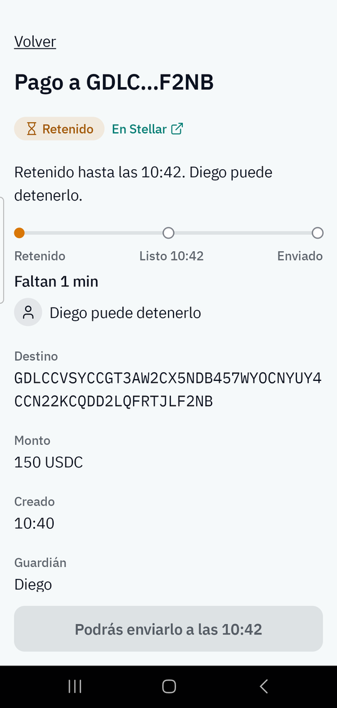
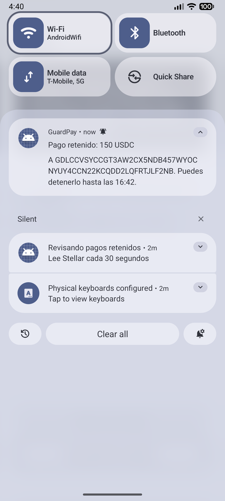
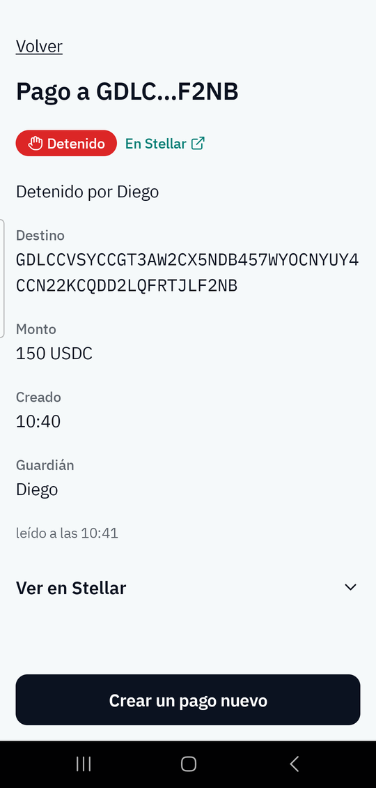
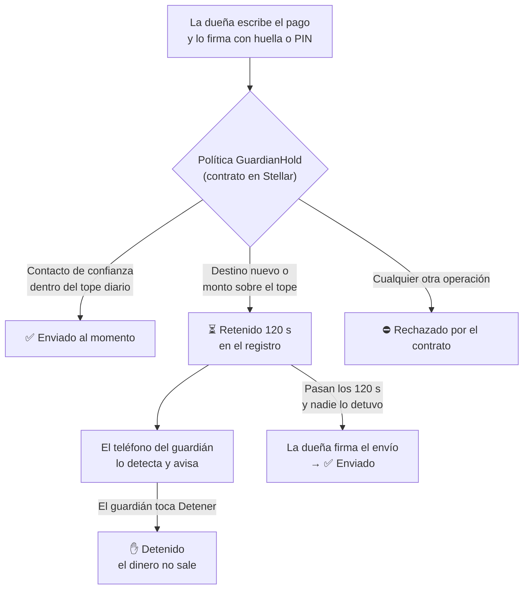
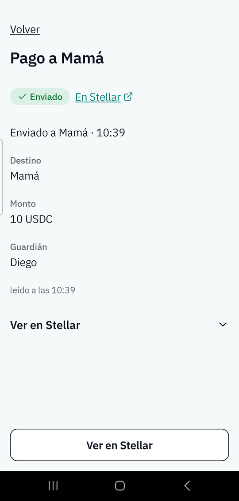
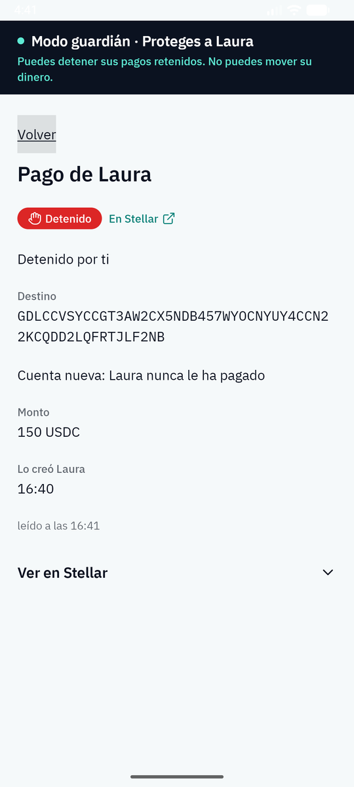
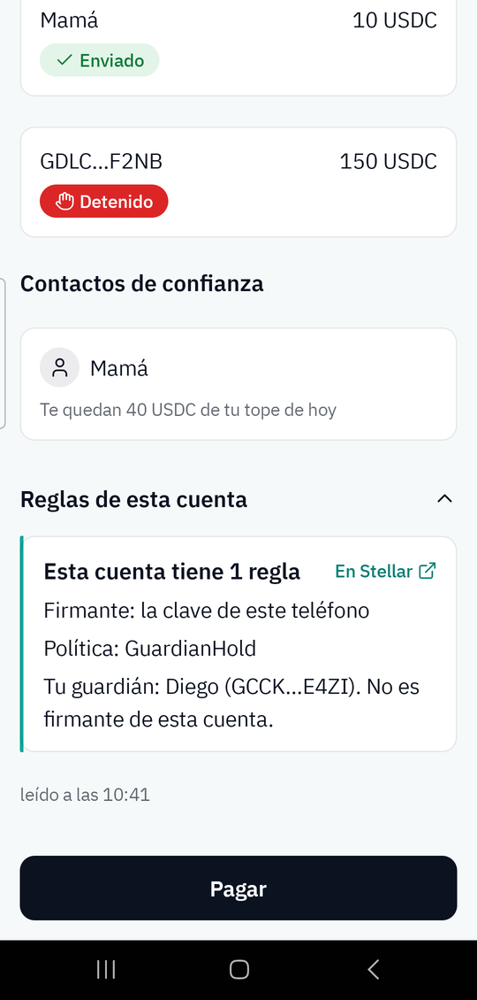
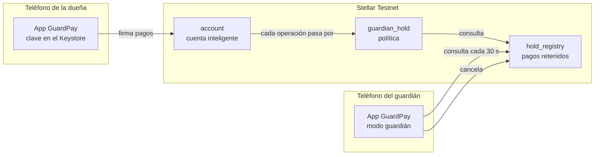

<a id="readme-top"></a>

<div align="center">

[![Red: Stellar Testnet][testnet-shield]][testnet-url]
[![Estado: MVP en testnet][estado-shield]](#estado-actual)
[![Contratos sin auditar][auditoria-shield]](#limitaciones-conocidas)
[![CI iOS (simulador)][ci-shield]][ci-url]

<h1>GuardPay</h1>

<p><strong>Una billetera que le da tiempo a alguien de confianza para detener un pago sospechoso antes de que salga.</strong></p>

<p><em>La IA advierte. Tú firmas. Tu guardián puede detener. El contrato rechaza lo demás.</em></p>

<p>
  <a href="#cómo-funciona"><strong>Cómo funciona »</strong></a>
  <br /><br />
  <a href="evidence/demo/full-rehearsal.md">Ver la demo cronometrada</a>
  &middot;
  <a href="#estado-actual">Estado actual</a>
  &middot;
  <a href="docs/ESTADO-FASES.md">Detalle por fase</a>
</p>

</div>

<table>
  <tr>
    <td align="center" width="33%"></td>
    <td align="center" width="33%"></td>
    <td align="center" width="33%"></td>
  </tr>
  <tr>
    <td align="center"><sub><b>1.</b> La dueña paga a una cuenta nueva. El contrato lo <b>retiene</b>.</sub></td>
    <td align="center"><sub><b>2.</b> El teléfono del guardián recibe un <b>aviso</b>.</sub></td>
    <td align="center"><sub><b>3.</b> El guardián lo <b>detiene</b>. El dinero no sale.</sub></td>
  </tr>
</table>

<p align="center"><sub>Capturas reales del 8 oct 2026, en Stellar Testnet: dueña en un Samsung Galaxy A54 y guardián en un emulador Android. Fuente: <a href="evidence/demo/full-rehearsal.md"><code>evidence/demo/full-rehearsal.md</code></a>.</sub></p>

> [!IMPORTANT]
> GuardPay es un **MVP que corre solo en Stellar Testnet**, con dinero de prueba. Los contratos **no están auditados**. No es un producto listo para usar con fondos reales.

<details>
  <summary><b>Contenido</b></summary>
  <ol>
    <li><a href="#el-problema">El problema</a></li>
    <li><a href="#la-solución">La solución</a></li>
    <li><a href="#cómo-funciona">Cómo funciona</a></li>
    <li><a href="#características">Características</a></li>
    <li><a href="#demostración">Demostración</a></li>
    <li><a href="#cómo-está-construido">Cómo está construido</a></li>
    <li><a href="#estado-actual">Estado actual</a></li>
    <li><a href="#limitaciones-conocidas">Limitaciones conocidas</a></li>
    <li><a href="#probarlo">Probarlo</a></li>
    <li><a href="#para-revisión-técnica">Para revisión técnica</a></li>
    <li><a href="#documentación">Documentación</a></li>
  </ol>
</details>

## El problema

En muchas estafas por mensaje, quien pierde el dinero es quien **autoriza el pago**. Llega un mensaje urgente: un familiar en apuros, un supuesto banco o un premio que hay que cobrar ya. Bajo presión, la persona transfiere a una cuenta que nunca había visto.

En ese momento la víctima tiene la clave y la intención de pagar, así que las protecciones habituales no ayudan. Y cuando alguien de confianza se entera, el dinero ya salió y no hay vuelta atrás.

En Costa Rica, el estudio de mercado del proyecto no encontró protecciones que permitan a otra persona intervenir antes de que el pago sea irreversible ([`docs/GuardPay — MVP Proposal.md`](docs/GuardPay%20—%20MVP%20Proposal.md)).

<p align="right">(<a href="#readme-top">volver arriba</a>)</p>

## La solución

GuardPay es una billetera móvil sobre Stellar que **separa los pagos habituales de los riesgosos**, y deja que una persona de confianza frene los riesgosos.

- **Los pagos de siempre salen al momento.** Si el destino es un contacto de confianza y el monto cabe en el tope diario, el pago sale sin espera.
- **Lo inusual espera.** Un destino nuevo, o un monto por encima del tope, queda **retenido 120 segundos** por el propio contrato.
- **El guardián puede detenerlo.** La dueña elige a esa persona, que recibe un aviso en su teléfono y puede detener el pago mientras está retenido.
- **El guardián no puede mover el dinero.** No es firmante de la cuenta. Solo puede detener.
- **Las reglas no dependen de la app.** Las aplica un contrato en Stellar, así que una app modificada o una firma robada no las saltan.

**Qué lo diferencia de una billetera convencional.** En una billetera común, una firma de la dueña basta para mover todo. En GuardPay esa firma pasa además por una política en cadena que decide si el pago sale, espera o se rechaza. Y existe un tercero que puede frenarlo sin tener poder sobre los fondos.

Ninguna pieza es nueva por separado: retención con tiempo (como `TimelockController` de OpenZeppelin), guardianes (Argent/Ready) y avisos de pagos (Yandex Pay, Monzo). GuardPay las combina en una cuenta de Stellar construida con piezas de OpenZeppelin. En EVM se podría hacer algo parecido con Safe, un módulo de retraso y un *guard*.

<p align="right">(<a href="#readme-top">volver arriba</a>)</p>

## Cómo funciona



1. **La dueña paga.** Elige destino y monto. La app le muestra antes de firmar si el pago sale ahora ("Sale ahora") o con espera ("Con espera"). Ella firma con huella o PIN, y la clave nunca sale del teléfono.
2. **El contrato decide.** Cada operación de la cuenta pasa por la política `GuardianHold`, que solo admite:
   - un pago a un contacto de confianza (hasta 3) dentro del tope diario;
   - poner un pago en espera en el registro;
   - enviar un pago retenido que ya cumplió su espera y coincide exactamente en cuenta, moneda, destino y monto;
   - que el guardián cancele un pago retenido.

   Todo lo demás se rechaza.
3. **El guardián se entera.** Su teléfono consulta la red cada 30 segundos y avisa cuando aparece un pago retenido. No hay servidor de por medio.
4. **El guardián decide.** Desde el aviso ve el destino y el monto, y puede detener el pago. Si lo detiene, ese pago no puede salir, aunque la dueña vuelva a firmar.
5. **Si nadie lo detiene**, a los 120 segundos la dueña puede enviarlo.

### Quién puede hacer qué

| | Puede | No puede |
| --- | --- | --- |
| **Dueña** | Pagar a sus contactos, retener pagos a destinos nuevos y enviarlos tras la espera | Saltarse la espera, aprobar a terceros (`approve`) ni usar otras monedas desde la cuenta |
| **Guardián** | Ver y detener los pagos retenidos de la dueña | Firmar pagos, mover fondos, cambiar reglas. No es firmante de la cuenta. |
| **Contrato** | Decidir si una operación sale, espera o se rechaza | Mover dinero por su cuenta: el registro no tiene ninguna función que transfiera fondos |
| **IA** *(prevista)* | Leer un mensaje y sugerir precaución | Firmar, rellenar destino o monto, ni ver saldos, contactos o claves. **Hoy no está activa.** |

<p align="right">(<a href="#readme-top">volver arriba</a>)</p>

## Características

| Característica | Estado |
| --- | --- |
| Pago inmediato a contactos de confianza dentro de un tope diario | ✅ Implementado y probado en testnet |
| Retención de 120 s para destinos nuevos o montos sobre el tope (la dueña también puede elegir retener un pago a un contacto) | ✅ Implementado y probado en testnet |
| El guardián detiene un pago desde el aviso en su teléfono | ✅ Probado entre dos dispositivos: un Galaxy A54 y un emulador |
| El guardián no es firmante y no puede mover fondos | ✅ Comprobado en cadena y con ataques ([escena 5](evidence/demo/scene-5.md)) |
| El contrato rechaza `approve`, pagos retenidos sin esperar y pagos detenidos | ✅ Rechazos registrados en testnet ([ensayo completo](evidence/demo/full-rehearsal.md)) |
| Clave de firma en el Android Keystore con huella o PIN | ✅ Implementado. Probado en emulador y en un Galaxy A54. |
| Pantalla "Reglas de esta cuenta" leída de la cadena | ✅ Implementado |
| Aviso al guardián sin servidor (consulta local cada 30 s) | 🟡 Funciona con la app activa. Puede llegar tarde si el sistema detiene el servicio. |
| App en iOS | 🟡 Solo en simulación, en el simulador del CI de macOS |
| Análisis de mensajes con IA en el teléfono | ⏳ No iniciado. Hoy la app responde que el análisis no está disponible. |
| Cambiar de guardián o recuperar la cuenta | ❌ No existe |
| Avisos push (FCM/APNs) o con la app cerrada | ❌ No existe; no hay backend por diseño |

<p align="right">(<a href="#readme-top">volver arriba</a>)</p>

## Demostración

Las seis escenas de la demo corrieron **dos veces seguidas, sin fallos, en 3:46 y 3:35 minutos**, el 8 oct 2026 en Stellar Testnet. Cada transacción tiene su hash comprobado en Horizon. Detalle completo: [`evidence/demo/full-rehearsal.md`](evidence/demo/full-rehearsal.md).

| # | Escena | Resultado |
| --- | --- | --- |
| 1 | Pagar 10 USDC de prueba a "Mamá", un contacto de confianza | Enviado al momento |
| 2 | Pagar 150 a una cuenta nueva, e intentar enviarlo sin esperar | Retenido; el envío inmediato se rechaza |
| 3 | El guardián lo detiene desde el aviso | Detenido, también en el teléfono de la dueña |
| 4 | La dueña intenta enviar el pago detenido | Rechazado por el contrato |
| 5 | El guardián intenta transferirse dinero a sí mismo | Rechazado: no es firmante |
| 6 | Aprobar a un tercero (`approve`) o añadir una regla nueva | `approve` rechazado; la cuenta no tiene función para añadir reglas y sigue con 1 regla |

<table>
  <tr>
    <td align="center" width="33%"></td>
    <td align="center" width="33%"></td>
    <td align="center" width="33%"></td>
  </tr>
  <tr>
    <td align="center"><sub>Pago a un contacto: sale al momento.</sub></td>
    <td align="center"><sub>Vista del guardián: puede detener, no mover dinero.</sub></td>
    <td align="center"><sub>La cuenta tiene 1 regla y el guardián no es firmante.</sub></td>
  </tr>
</table>

Las escenas de terminal (2, 4, 5 y 6) usaron otra cuenta de testnet con claves desechables, porque las claves del Keystore no salen del teléfono. Un guion manejó los dispositivos; una persona puso la huella.

Más material:

- [Los 9 estados de pago a 360 dp](evidence/demo/screens/): Borrador, Firmando, Retenido, Listo para enviar, Enviado, Detenido, Vencido, Rechazado y Error de red. Son **simulados**: la interfaz real dibujada sin red.
- [Dos dispositivos](evidence/demo/two-devices-android.md): dueña en el Galaxy A54 y guardián en el emulador. Es **real**.
- [Teléfono físico](evidence/demo/physical-phone.md): escenas 1, 2, 3 y 6 en el Galaxy A54. Es **real**.
- [Vídeos de los ensayos](evidence/demo/video.md).

<p align="right">(<a href="#readme-top">volver arriba</a>)</p>

## Cómo está construido

GuardPay tiene dos mitades: **contratos en Stellar** que imponen las reglas, y una **app móvil** que las hace usables. No hay servidor propio.



**En la cadena** hay tres contratos Soroban escritos en Rust:

| Contrato | Qué hace |
| --- | --- |
| `account` | La cuenta de la dueña, armada con piezas de OpenZeppelin. Tiene **una sola regla** (firmante: la dueña; política: `guardian_hold`). No tiene funciones para ejecutar código arbitrario, actualizarse ni añadir firmantes o reglas. |
| `guardian_hold` | La política. Admite solo la lista cerrada de operaciones descrita arriba y rechaza todo lo demás. Nunca llama a un token. |
| `hold_registry` | Guarda los pagos retenidos y calcula por su cuenta cuándo maduran. Solo el guardián puede cancelar. No tiene funciones que muevan fondos. |

**En el teléfono:**

- **Kotlin Multiplatform y Compose Multiplatform.** Una sola base de código para la lógica y la interfaz. Android es la plataforma de la demo. iOS compila y abre en el simulador, solo en simulación.
- **Android Keystore.** Guarda la clave ed25519 y pide huella o PIN en cada firma.
- **Stellar SDK para Kotlin** (`com.soneso.stellar:stellar-sdk` 1.14.0). Construye las transacciones y lee la red.
- **Firma acotada.** La app firma solo la llamada exacta que ella misma construyó (`AuthEntryGuard`).
- **IA aislada.** El módulo de IA tiene una única función y, por diseño, no puede ver claves, saldos ni la conexión a Stellar. Una prueba automática lo comprueba.

<p align="right">(<a href="#readme-top">volver arriba</a>)</p>

## Estado actual

**Implementado y probado en testnet**

- Los tres contratos, desplegados en Stellar Testnet ([`evidence/stellar/deployment.md`](evidence/stellar/deployment.md)).
- La entrada y las cuatro pantallas de la app con datos de testnet: Inicio, Pagar, Detalle y Guardián. Probadas en un emulador y en un Galaxy A54.
- La firma con huella o PIN: `transfer`, `queue` y `cancel` firmados desde el A54.
- El aviso al guardián sin servidor, medido por debajo de 60 s ([`evidence/guardian/notification.md`](evidence/guardian/notification.md)).
- La demo completa de seis escenas, dos veces por debajo de 5 minutos.
- Ataques documentados en una matriz por cuenta ([`evidence/security/bypass-matrix.md`](evidence/security/bypass-matrix.md)).

**Parcial**

- **iOS:** solo en el simulador del CI de macOS, con la simulación en memoria. Nada se firma con una clave real, nada va contra testnet y nada se probó en un iPhone ([`evidence/ios/simulator.md`](evidence/ios/simulator.md)).
- **Dispositivos:** la prueba entre dos dispositivos usó un teléfono físico y un emulador, no dos teléfonos físicos.
- **Ataques:** GH-29, GH-30 y GH-33 están sin correr. Algunos ataques solo tienen hash en una cuenta de pruebas concreta (ver [revisión técnica](#para-revisión-técnica)).

**No iniciado**

- **IA en el teléfono:** la prueba de viabilidad (Spike B) salió en rojo y la fase P7 no se abrió. La app responde que el análisis no está disponible, y la retención no depende de la IA.
- **Entrevistas con usuarios:** sin correr ([`evidence/interviews.md`](evidence/interviews.md)).

Las firmas de revisión humana CP-3, CP-7 y CP-9 siguen pendientes. El detalle por fase está en [`docs/ESTADO-FASES.md`](docs/ESTADO-FASES.md). Toda la evidencia está en [`evidence/`](evidence/), etiquetada **REAL**, **SIMULATED** o **ILLUSTRATIVE**. Lo que no se corrió está escrito como "no corrido".

<p align="right">(<a href="#readme-top">volver arriba</a>)</p>

## Limitaciones conocidas

- **Solo testnet.** El activo es un token de prueba (un SAC emitido por la dueña), no el USDC de Circle. El administrador de ese token es la dueña. `mint` y `clawback` no pasan por la política, y no se ejecutaron con esa clave.
- **Contratos sin auditar.** OpenZeppelin está fijado a un commit previo a una versión estable (`b40c5ea`), no al tag v0.7.2.
- **Si el guardián no mira, nadie detiene nada.** La espera es fija, de 120 segundos. Un pago retenido que ya maduró no caduca dentro del contrato.
- **El guardián no se puede cambiar**, y no hay recuperación de cuenta.
- **El diálogo de firma no muestra el pago.** El sistema muestra "Firmar en Stellar", pero la clave firma un hash sin ver destino ni monto. Lo mitigan la retención en cadena y la vista del guardián, no la clave.
- **El aviso depende de que el servicio siga vivo.** No hay servidor, FCM ni APNs. El teléfono del guardián consulta la red cada 30 s desde un servicio en primer plano. Si el sistema lo detiene (ahorro de batería, restricciones del fabricante, cierre forzado o el tope de unas 6 h/día de `dataSync` en Android 15+), el aviso llega cuando se abra la app o se toque "Actualizar". Consultar cada 30 s no es aceptable en batería para producción.
- **Configuración por dispositivo.** En el build de depuración, cada teléfono crea las claves de dueña y de guardián, y un archivo `testnet.json` decide su rol: ambos, solo dueña o solo guardián.
- **Las pruebas cubren poco hardware.** Se probó en un emulador Android (API 37) y en un Galaxy A54. El ciclo retener → esperar → enviar y los casos GH-01/GH-24 no se repitieron en el teléfono físico.
- **Los pagos inmediatos no se releen.** Un pago a un contacto queda en la cadena, pero desaparece de "Recientes" si se reinicia la app. Los pagos retenidos sí se vuelven a leer del registro.
- **La demo cronometrada no usó una sola cuenta.** Las escenas de app y las de terminal corrieron sobre cuentas distintas, y las manejó un guion, no una persona presentando.
- **El build de release no se conecta a nada todavía.**

<p align="right">(<a href="#readme-top">volver arriba</a>)</p>

## Probarlo

### Requisitos

- JDK 17 y Gradle por el wrapper incluido (8.14.3).
- Android SDK, con la ruta en `local.properties`: `sdk.dir=C:/Users/<tú>/AppData/Local/Android/Sdk`.
- Para los contratos: Rust, con el target `wasm32v1-none`, y `stellar-cli` 28.1.0.
- Para la app conectada: un Android 13+ con bloqueo de pantalla.

### Compilar y correr las pruebas

Pruebas de la lógica compartida y comprobaciones de arquitectura (sin red):

```bash
./gradlew :app:shared:allTests
```

APK de depuración, que queda en `app/android/build/outputs/apk/debug/`:

```bash
./gradlew :app:android:assembleDebug
```

Pruebas de los contratos:

```bash
cargo test -p account -p guardian_hold -p hold_registry
```

Pruebas instrumentadas del Keystore (Android 13+ con bloqueo de pantalla). Primero:

```bash
./gradlew :app:android:installDebugAndroidTest
```

Después:

```bash
adb shell am instrument -w -r com.guardpay.android.test/androidx.test.runner.AndroidJUnitRunner
```

### Conectar un teléfono a testnet (build de depuración)

1. Instala el APK de depuración y ábrelo una vez. La app crea las dos claves en el Keystore y escribe sus direcciones públicas en `/sdcard/Android/data/com.guardpay.android/files/keys.json`.
2. Lee ese archivo (`adb shell cat …/keys.json`) y despliega una cuenta para esas claves:
   ```bash
   ./gradlew :app:shared:testDebugUnitTest -PliveTestnet -Pgp.owner=G... -Pgp.guardian=G... --tests "*DeviceProvisioningLiveTest"
   ```
3. Sube el resultado y vuelve a abrir la app:
   ```bash
   adb push app/shared/build/testnet.json /sdcard/Android/data/com.guardpay.android/files/testnet.json
   ```

Ningún paso usa una semilla: solo entran y salen direcciones públicas. Sin `testnet.json`, la app corre una simulación en memoria, marcada con el aviso "Simulación".

Para dos dispositivos, provisiona con la clave de dueña de uno y la de guardián del otro, y sube el mismo archivo a ambos ([`evidence/demo/two-devices-android.md`](evidence/demo/two-devices-android.md)). Más comandos en [`app/README.md`](app/README.md) y [`CLAUDE.md`](CLAUDE.md).

<p align="right">(<a href="#readme-top">volver arriba</a>)</p>

## Para revisión técnica

<details>
<summary><b>Qué se demuestra y qué no</b></summary>

Se demuestra, con un hash o una lectura de la cadena, solo lo que citan estos puntos. Lo que no tiene archivo aquí no se afirma.

1. La cuenta publicada tiene una sola regla `Default`: firmante, la dueña; política, `guardian_hold`. El guardián no es firmante. Evidencia: [`evidence/smart-account/rules-onchain.md`](evidence/smart-account/rules-onchain.md) y [`evidence/security/chain-reread.md`](evidence/security/chain-reread.md).
2. Un pago a un contacto dentro del tope se incluye. Un pago a un destino que no es contacto queda en el registro. Evidencia: [`evidence/demo/rehearsal.md`](evidence/demo/rehearsal.md), [`evidence/demo/scene-1.md`](evidence/demo/scene-1.md) y [`evidence/demo/scene-2.md`](evidence/demo/scene-2.md).
3. El guardián puede cancelar un pago retenido, y no puede mover el token. Evidencia: [`evidence/demo/scene-3.md`](evidence/demo/scene-3.md) y [`evidence/demo/scene-5.md`](evidence/demo/scene-5.md).
4. Un pago detenido no sale con una firma de la dueña. Evidencia: [`evidence/demo/scene-4.md`](evidence/demo/scene-4.md).
5. No hay servidor de pagos, y el aviso es local. Evidencia: [`evidence/guardian/notification.md`](evidence/guardian/notification.md).

No se demuestra:

- una auditoría;
- mainnet;
- iOS en un dispositivo;
- la IA en el teléfono;
- que el aviso llegue con la app cerrada;
- que el guardián se pueda cambiar;
- un vencimiento a los 600 s.

GH-29, GH-30 y GH-33 están sin correr. GH-28 está en verde solo para la cuenta de ataques `CC6FFXGG…` y su wasm `06226b37…`.

</details>

<details>
<summary><b>Cuentas de testnet y wasm</b></summary>

Un hash pertenece a la cuenta de su columna, y el wasm va con la cuenta.

| | Publicada | Ataques | Emulador | Dos dispositivos y demo cronometrada |
| --- | --- | --- | --- | --- |
| account | `CDBJMSUIWL3RCA4POESJQSPHUJ4KOMQE7OTFAO27DDAFXKDBXRNTDEZX` | `CC6FFXGGF62OPCRCL4FQLABPUMEGZ6JQ7XVETDJ5MOLWQGNA4SQYPHFP` | `CDWPPTDMACOEVMBUHBBTPUW2EEDXY6YVUAOZJFTSGGOBAONCAJ7WGFV6` | `CA5Z7JZSGBUXGVV7FDW5B6M66PJCAXHYIQJDG7GXZST3VFTOQE4ARA2J` |
| wasm de `account` | `986956cc…cf3b` | `06226b37…ea9c` (sin optimizar) | `986956cc…cf3b` | `986956cc…cf3b` |
| Evidencia | [`deployment.md`](evidence/stellar/deployment.md) | [`bypass-matrix.md`](evidence/security/bypass-matrix.md) | [`rehearsal.md`](evidence/demo/rehearsal.md) | [`full-rehearsal.md`](evidence/demo/full-rehearsal.md) |

- Los ataques con destino distinto, monto distinto, dirección *muxed*, contrato intermedio y GH-28 tienen hash solo en `CC6FFXGG…`.
- La cuenta del emulador no se usó para firmar ataques, porque la clave del Keystore no sale del teléfono.
- Las escenas de terminal de la demo cronometrada usaron una quinta cuenta desechable, `CBE2VJ37…`.

</details>

<details>
<summary><b>Scripts de ataque y redespliegue</b></summary>

Hay un script por caso en [`scripts/attacks/`](scripts/attacks/).

- **Los `.ps1`, `run.mjs` e `invoke.mjs`** leen `scripts/.testnet/state.json`. Con el estado del 6 oct por la noche, enviaron las transacciones de `CC6FFXGG…`. En Linux: `bash scripts/attacks/run.sh held-after-cancel`.
- **Los `.sh` de `common.sh` y `run-all.sh`** se corrieron contra la cuenta publicada. Log: [`evidence/security/p9-cli-run.log`](evidence/security/p9-cli-run.log).
- **`same-ledger.ps1`** escribió una fila "mismo ledger" a partir de dos lecturas vacías. Esa fila no se usa.
- Ningún script imprime semillas.

Para redesplegar en testnet hay dos scripts: [`scripts/deploy-testnet.ps1`](scripts/deploy-testnet.ps1) (Windows) y [`scripts/deploy-testnet.sh`](scripts/deploy-testnet.sh). Solo testnet. Las semillas quedan en `scripts/.testnet/`, que git ignora.

</details>

<details>
<summary><b>Versiones fijadas</b></summary>

| Pieza | Versión |
| --- | --- |
| OpenZeppelin `stellar-contracts` | commit `b40c5eaefe6a29f0030f00bd2d730b7a91cce330` (pre-release, vendorizado en `vendor/`) |
| `soroban-sdk` | 28.0.0 |
| Target de los contratos | `wasm32v1-none` |
| `stellar-cli` | 28.1.0 |
| `com.soneso.stellar:stellar-sdk` | 1.14.0 |
| Gradle | 8.14.3 (wrapper) |

</details>

<p align="right">(<a href="#readme-top">volver arriba</a>)</p>

## Documentación

Toda la documentación de diseño está en español, en [`docs/`](docs/). Algunos documentos se contradicen. Cuando no coinciden, manda el que está más arriba en esta lista:

1. [`GuardPay — Plan de construcción.md`](docs/GuardPay%20—%20Plan%20de%20construcción.md): el plan vigente (arquitectura, fases P0–P10 y riesgos).
2. [`GuardPay — Prompts de ejecución.md`](docs/GuardPay%20—%20Prompts%20de%20ejecución.md): una instrucción por fase.
3. [`GuardPay — Security spike y propuesta web definitiva.md`](docs/GuardPay%20—%20Security%20spike%20y%20propuesta%20web%20definitiva.md): manda en el **diseño de los contratos** y en las pruebas adversarias GH-01…GH-33. Su conclusión de "app web" quedó reemplazada por la app móvil.
4. [`GuardPay — Propuesta visual.md`](docs/GuardPay%20—%20Propuesta%20visual.md): manda en el **diseño** (paleta, los 9 estados y las pantallas).
5. [`GuardPay — MVP Proposal.md`](docs/GuardPay%20—%20MVP%20Proposal.md): manda en el **alcance** y los criterios de aceptación.
6. [`GuardPay — Propuesta para el pitch.md`](docs/GuardPay%20—%20Propuesta%20para%20el%20pitch.md): **obsoleto en lo técnico**. El contrato `TrustedPayee` separado, la política Spending Limit y Stellar Channels ya no existen.
7. [`GuardPay — Validación Costa Rica y Chile.md`](docs/GuardPay%20—%20Validación%20Costa%20Rica%20y%20Chile.md): evidencia de mercado.

Otros documentos de referencia:

- [`docs/INTERFACES.md`](docs/INTERFACES.md): las firmas de los contratos.
- [`docs/DEPENDENCIES.md`](docs/DEPENDENCIES.md): las dependencias.
- [`app/README.md`](app/README.md): la app.

<p align="right">(<a href="#readme-top">volver arriba</a>)</p>

<!-- ENLACES E INSIGNIAS -->
[testnet-shield]: https://img.shields.io/badge/red-Stellar%20Testnet-0B1220?style=for-the-badge&logo=stellar&logoColor=white
[testnet-url]: https://developers.stellar.org/docs/networks
[estado-shield]: https://img.shields.io/badge/estado-MVP-A25904?style=for-the-badge
[auditoria-shield]: https://img.shields.io/badge/contratos-sin%20auditar-B42318?style=for-the-badge
[ci-shield]: https://img.shields.io/github/actions/workflow/status/CHMP987/GuardPay/ios.yml?branch=ios&style=for-the-badge&label=CI%20iOS%20simulador
[ci-url]: https://github.com/CHMP987/GuardPay/actions/workflows/ios.yml
